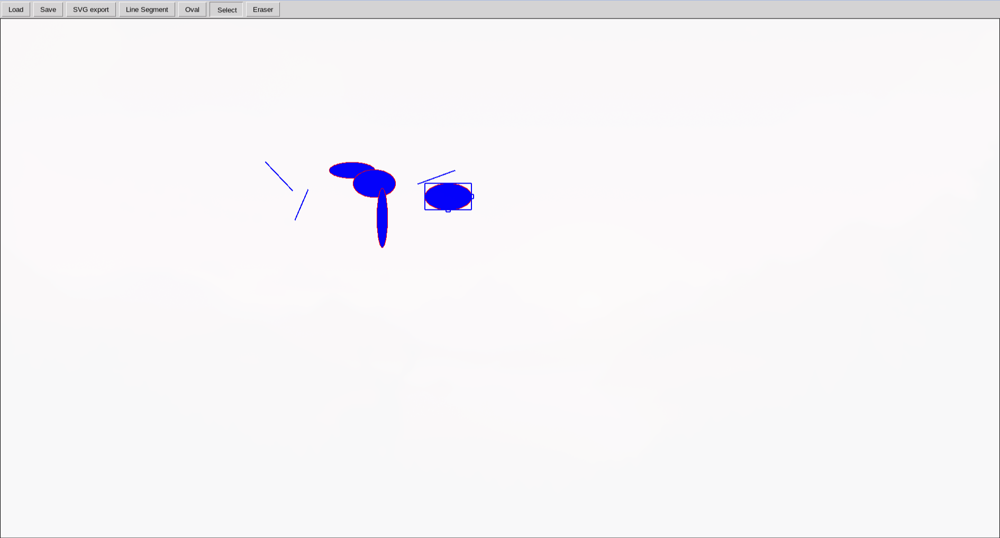

# OOUP Lab - Graphics Editor

A Python-based 2D graphics editor demonstrating object-oriented design patterns.



## Features

### Shape Creation
- **Line Segment** - Draw lines defined by start and end points
- **Oval** - Draw filled ovals/ellipses defined by control points

### Shape Manipulation
- **Selection** - Click to select shapes; Ctrl+click for multi-selection
- **Drag to move** - Drag selected shapes to reposition them
- **Hot point editing** - Drag shape control points to modify geometry
- **Keyboard nudging** - Arrow keys move selected shapes by 1 pixel

### Shape Organization
- **Z-order control** - Use +/- keys to move shapes forward/backward in layer order
- **Grouping** - Press 'G' to group multiple selected shapes into a composite
- **Ungrouping** - Press 'U' to ungroup a selected composite shape

### Eraser Tool
- Freehand eraser path that removes any shapes it intersects

### File Operations
- **Load** - Import shapes from `.txt` files
- **Save** - Export current canvas to `.txt` files
- **SVG Export** - Export canvas to `.svg` files

## Design Patterns

### State Pattern
The application uses a state machine to handle different interaction modes:
- `IdleState` - Default state with no active tool
- `AddShapeState` - Creating new shapes
- `SelectShapeState` - Selecting and manipulating shapes
- `EraserState` - Erasing shapes

All states implement the `State` interface.

### Strategy Pattern
Different rendering strategies are available through the `Renderer` interface:
- `G2DRenderer` - Renders to tkinter canvas
- `SVGRenderer` - Renders to SVG files

### Observer Pattern
Two-level observer system for change notification:
- `DocumentModelListener` - Listens for document-wide changes
- `GraphicalObjectListener` - Listens for individual object changes

The `DocumentModel` observes all graphical objects and notifies canvas listeners when changes occur.

### Composite Pattern
`CompositeShape` allows treating groups of shapes as a single object. Composites support all operations available to individual shapes (render, translate, selection, etc.).

### Prototype Pattern
Shapes serve as prototypes for creating new instances. The toolbar stores prototype objects that are duplicated when creating new shapes on the canvas.

### Factory Method (via Prototype)
Shape creation uses prototype duplication rather than direct instantiation, allowing uniform creation of both simple and composite shapes.

### Bridge Pattern
Separation between `GraphicalObject` abstraction and `Renderer` implementation allows independent variation of shapes and rendering targets.

### Decorator Pattern
The `activate_button` decorator wraps toolbar button commands to manage visual button state (raised/sunken).

## Architecture

```
main.py          - Application entry point
gui.py           - Main window and toolbar management
canvas.py        - Drawing surface and event binding
document_model.py - Central model managing all shapes

graphical_object/
  interface.py   - GraphicalObject contract
  abstract_go.py - Base implementation with hot point support
  line_segment.py - Line shape implementation
  oval.py        - Oval shape implementation
  composite.py   - Composite shape for grouping
  eraser_path.py - Temporary path for eraser tool

state/
  interface.py   - State contract
  idle.py        - Default state
  add_shape.py   - Shape creation state
  select_shape.py - Selection/manipulation state
  eraser.py      - Eraser state

renderer/
  interface.py   - Renderer contract
  g2d_renderer.py - Tkinter canvas renderer
  svg_renderer.py - SVG file renderer
```

## Requirements

- Python 3.x

## Usage

```bash
python main.py
```

## File Format

The `.txt` save format stores each shape on separate lines:
- Lines starting with `@LINE` followed by coordinates
- Lines starting with `@OVAL` followed by coordinates
- `@COMP` entries define composite shapes with child count
